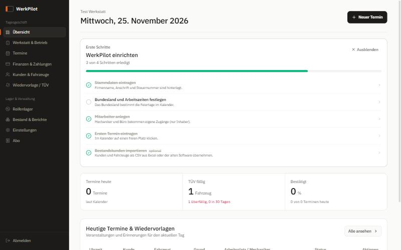
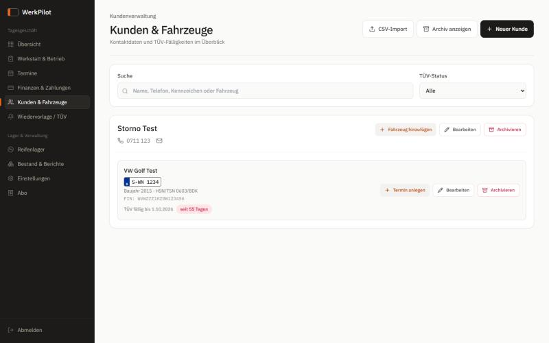

# WerkPilot

Workshop management for independent car repair shops in Germany (Kfz-Werkstätten): appointments, work orders, estimates, stock, invoices and TÜV reminders in one multi-tenant web app. The interface is in German.

This is a portfolio project. It is not in production and has no real customers.



## What it does

- **Appointments.** Week and day calendar with drag and drop, bays and mechanics. Overlapping bookings are rejected by the database, not just the UI.
- **Work orders.** `draft → estimate → approved → in_progress → completed → invoiced`. Parts are reserved when an order is approved and booked out when work starts.
- **Online estimate approval.** The customer gets a link (`/freigabe/<token>`), sees the estimate without an account and approves or declines it. Only the SHA-256 hash of the token is stored, and the decision cannot be changed afterwards.
- **Invoices that follow GoBD.** An issued invoice and its lines are immutable (database triggers). Corrections go through a cancellation document with negative lines. Invoice numbers have no gaps. PDF output and ZUGFeRD / Factur-X XML.
- **Customers and vehicles.** CSV import from Excel or older software, vehicle registration (Fahrzeugschein) recognition with OCR, archiving instead of deleting.
- **TÜV follow-up.** Due and overdue inspections with reminders that respect each customer's consent.
- **Tire storage, stock, reports** and an audit log of who changed what.
- **Staff roles.** Owner, office and mechanic. Mechanics do not see purchase prices.
- **Self-service sign-up** with e-mail confirmation and an optional Stripe subscription with a 30-day trial.



## Stack

Next.js 14 (App Router), TypeScript, Tailwind CSS, Supabase (Postgres and Auth, Frankfurt region), Drizzle ORM, Vitest, Sentry, Stripe.

## Engineering notes

**Tenant isolation in the database.** Every table has row-level security enabled and forced. All queries run through `withTenant` / `withUser` (`db/with-tenant.ts`, `db/with-user.ts`), which open a transaction and switch to the `authenticated` role, so Postgres enforces the policies even if application code forgets a filter. Queries still filter by `tenant_id` as a second line of defence. RLS has its own test suite in `db/*.test.ts`.

**Public access without a privileged key.** The only page without login, the estimate approval link, looks up the token through a single `SECURITY DEFINER` function callable by the `anon` role. The customer's answer is written as the staff member who created the link, so the usual policies and stock checks still apply. Public endpoints are rate limited per hashed IP.

**Money and dates.** Amounts are integer cents, quantities are stored in thousandths, VAT rates in basis points. Rounding is half away from zero, so a cancellation mirrors its invoice exactly. Dates and the invoice year are computed in `Europe/Berlin`, not UTC.

**Small pure functions.** Business rules live in `lib/` as plain functions with unit tests next to them (about 700 tests). API routes only translate errors: 401 without a session, 400 on validation, 409 on conflicts.

**Schema changes** go through Drizzle migrations in `drizzle/` (31 so far). Existing migrations are never edited.

## Running it locally

You need Node 20+ and a Supabase project.

```bash
npm install
cp .env.example .env.local   # fill in the Supabase URL, publishable key and DATABASE_URL
npm run db:migrate            # apply the migrations to your database
npm run dev
```

Open http://localhost:3000, register a workshop and confirm the e-mail.

Stripe and Sentry are optional. Without `STRIPE_SECRET_KEY`, `STRIPE_WEBHOOK_SECRET` and `STRIPE_PRICE_ID` billing is switched off and nobody is locked out. Without a Sentry DSN no errors are reported.

## Checks

```bash
npx tsc --noEmit
npm run lint
npm test
```

The database tests (RLS, triggers, functions) run only when `RLS_TEST_DATABASE_URL` points at a disposable test database. Otherwise they are skipped.

## Project layout

```
app/          pages and API routes (one folder per area: termine, werkstatt, finanzen, kunden, ...)
components/   UI components
lib/          business logic as pure functions, with tests
db/           schema, tenant-scoped database access, RLS tests
drizzle/      SQL migrations
```
